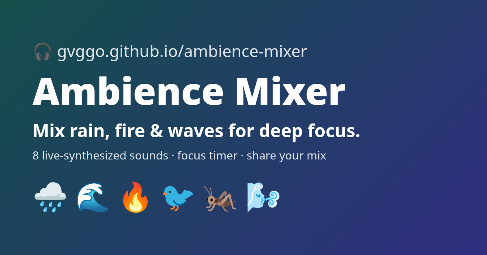

# 🎧 Ambience Mixer

**Mix rain, ocean, campfire, wind, birds, crickets, brown noise and a warm drone into your own focus or sleep soundscape — every sound synthesized live in the browser, no audio files.**

▶ **Listen:** https://gvggo.github.io/ambience-mixer/

## Features
- 8 layers with individual volume, plus master volume.
- Presets: Rainy library, Beach nap, Cabin campfire, Deep focus, Summer night, Forest morning.
- Focus timer (15/25/50/90 min) with an optional gentle fade-out; countdown shows in the tab title.
- **Share your mix:** the mix is encoded in the link, e.g. `#mix=rain:70,fire:30` — friends open it and hear the same blend.

## How the sounds are made (Web Audio API)
| Sound | Recipe |
|---|---|
| Rain | pink noise, high/low-passed, plus a band-passed white-noise "hiss" |
| Ocean | brown noise through a low-pass whose cutoff and gain swell with a slow 0.075 Hz LFO |
| Wind | white noise through a band-pass with a wandering center frequency |
| Campfire | low-passed brown-noise rumble + randomly timed, decaying noise "crackles" |
| Birds | short sine chirps with exponential pitch sweeps at random intervals |
| Crickets | 4.4 kHz tone amplitude-gated at 28 Hz, chirping on and off |
| Brown noise | integrated white noise (Brownian), low-passed |
| Warm drone | detuned sine/triangle chord (A2–C#4) with slow breathing |

Noise generators (white, pink via Paul Kellet's filter, brown) live in `logic.js` and are unit-tested.

## Run locally
Open `index.html` (tap play — browsers require a user gesture for audio). Tests: `node tests/logic.test.mjs`.

## Privacy
No backend, no analytics. The mix is stored in `localStorage` and the page link.

## Tech
Vanilla HTML/CSS/JS + Web Audio API · GitHub Pages. Built with AI assistance as a portfolio project.

## License
MIT
